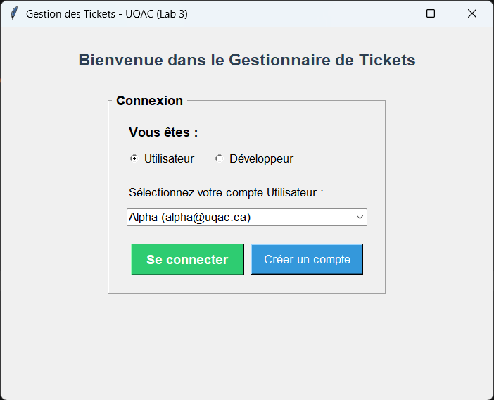
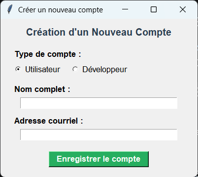
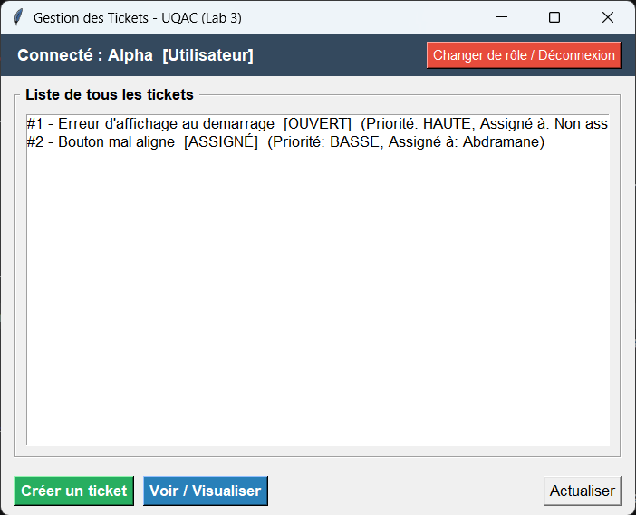
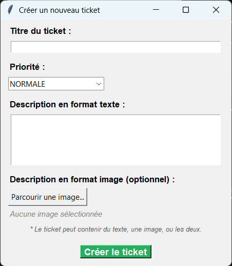
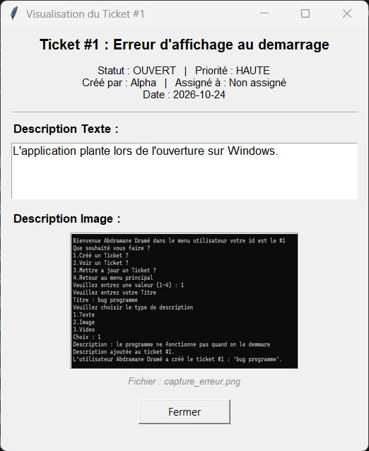
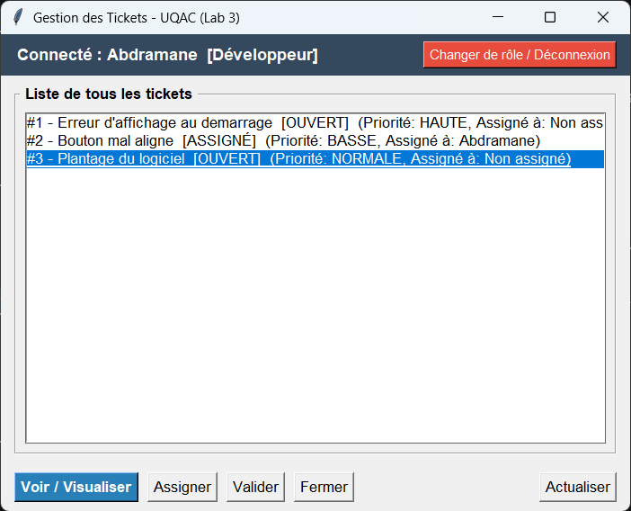
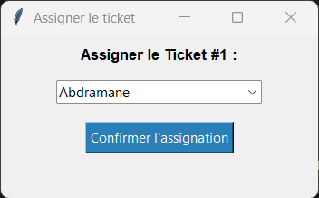
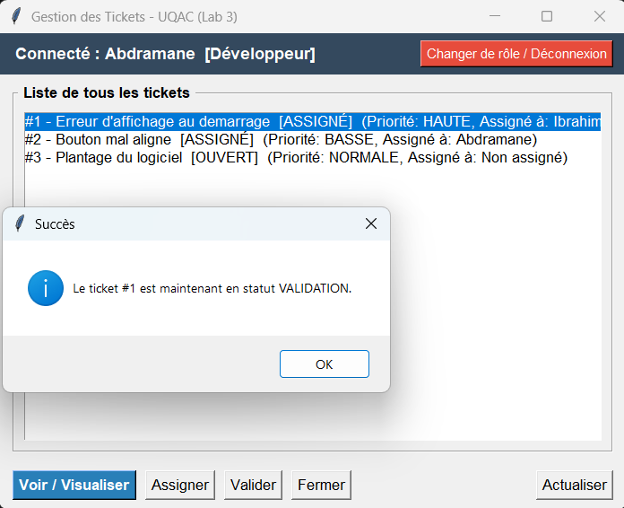
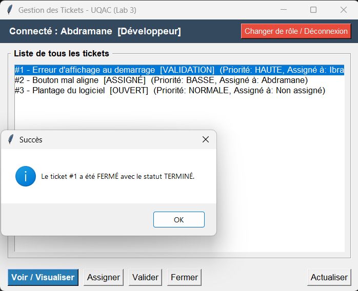

# 6GEI311 – Laboratoire 3 : Interface Graphique (Tkinter)

**Cours :** Architecture des logiciels (6GEI311)  
**Session :** Automne 2026  
**Université du Québec à Chicoutimi (UQAC)**  

**Équipe :**
- **Dramé, Abdramane** (Code permanent : DRAA04070300)
- **Doumbia, Ibrahim** (Code permanent : )

**Dépôt GitHub :** https://github.com/abdouldrame09/6GEI311_Laboratoire3.git

---

## Section I — Objectif du laboratoire

Dans ce troisième laboratoire, notre objectif était de transformer notre système de gestion de tickets du Lab 2 (qui fonctionnait uniquement en console) en une vraie application graphique avec Python et Tkinter.

L'idée était d'offrir une interface simple et claire pour les utilisateurs et les développeurs, tout en gardant intacte la logique métier qu'on avait mise en place au laboratoire précédent. Le programme doit permettre de gérer des tickets avec des descriptions en texte et en image (ou les deux à la fois), et de visualiser directement ces descriptions dans la fenêtre.

---

## Section II — Description du travail réalisé

Pour ce laboratoire, nous avons séparé le code de l'interface graphique du reste du programme pour que le projet reste propre et facile à maintenir. Le fichier `ApplicationGUI.py` contient toute la logique de l'interface graphique Tkinter, tandis que `main.py` sert uniquement de point d'entrée pour charger les données de test en mémoire et lancer l'application.

Les composantes principales du système sont :
- **ApplicationGUI** : gère l'affichage des fenêtres, l'écran de connexion, les formulaires de saisie et la liste des tickets.
- **main.py** : démarre l'application et initialise les utilisateurs, les développeurs et les tickets par défaut.
- **User et Developpeur** : `User` permet de créer des tickets et de les consulter, tandis que `Developpeur` hérite de `User` et ajoute les actions de gestion (assigner, valider, fermer).
- **Ticket** : stocke les informations du ticket comme le titre, la priorité, le statut, le créateur, le développeur assigné et la liste des descriptions.
- **DescriptionTicket, TextObject et ImageObject** : `DescriptionTicket` est la classe abstraite de base, et ses sous-classes permettent de stocker soit un texte explicatif, soit le chemin vers une image de capture d'écran.
- **DescriptionFactory** : fabrique qui crée le bon type d'objet description selon le besoin.
- **GestionnaireTickets** : garde la liste de tous les tickets en mémoire sans base de données.
- **Enums** : regroupent les constantes du système pour `Statut`, `Priorite` et `TypeDescription`.

---

## Section III — Fonctionnalités principales

### 1. Connexion et gestion des comptes
Dès l'ouverture, l'application affiche un écran de connexion où l'on choisit si on se connecte en tant qu'Utilisateur ou Développeur. La liste déroulante filtre automatiquement les personnes selon le rôle choisi. On a aussi ajouté un bouton pour créer un nouveau compte sur place (nom et courriel) sans redémarrer le programme. Un bouton de déconnexion permet aussi de changer d'utilisateur à tout moment.

### 2. Interface graphique adaptée aux rôles
L'interface montre la liste de tous les tickets existants avec leurs informations principales (ID, titre, statut, priorité, créateur, assigné). Les boutons d'action s'adaptent selon la personne connectée :
- Un **Utilisateur** peut créer un ticket et visualiser les tickets existants.
- Un **Développeur** peut visualiser les tickets, s'assigner ou assigner un ticket à un collègue, valider la correction d'un ticket, et fermer définitivement un ticket terminé.

### 3. Prise en charge des descriptions et affichage des images
Lors de la création d'un ticket, on peut entrer un titre, choisir une priorité, taper une explication textuelle et sélectionner une image sur son ordinateur grâce à un explorateur de fichiers (`filedialog`). Un ticket peut contenir du texte seul, une image seule, ou les deux ensemble. Lorsqu'on clique sur le bouton pour voir un ticket, une nouvelle fenêtre s'affiche avec toutes les infos, le texte complet et la capture d'écran redimensionnée directement dans la fenêtre avec la bibliothèque Pillow.

---

## Section IV — Défis rencontrés

Pendant le développement de cette interface graphique, nous avons fait face à quelques difficultés :

- **L'affichage et le redimensionnement des images :** Tkinter ne gère pas nativement plusieurs formats d'images modernes ni le redimensionnement automatique. On a donc utilisé la bibliothèque Pillow (`PIL`) pour charger les images et les redimensionner proportionnellement afin qu'elles s'affichent proprement dans la fenêtre sans dépasser ni se déformer.
- **La persistance des images dans Tkinter :** Au début, l'image disparaissait immédiatement après l'ouverture de la fenêtre. On a compris que le ramasse-miettes de Python (`garbage collector`) supprimait la variable de l'image en mémoire si elle n'était pas attachée directement au composant d'affichage (`lbl.image = photo`).
- **La séparation des rôles et la navigation :** On voulait que l'utilisateur puisse se déconnecter et basculer entre le profil utilisateur et développeur sans fermer l'application. On a dû bien organiser nos cadres (`frames`) pour masquer l'écran de connexion et afficher l'espace de travail correspondant sans créer de conflits d'affichage.
- **La mise à jour de l'affichage en direct :** Il fallait s'assurer qu'après chaque création, assignation ou changement de statut, la liste des tickets se rafraîchisse automatiquement sans obliger l'utilisateur à redémarrer.

---

## Section V — Ce que nous avons appris

Ce laboratoire nous a permis de voir concrètement l'intérêt de la modificabilité et du découplage qu'on avait travaillés au Lab 2. Comme notre logique métier était déjà bien découpée en classes indépendantes, on a pu brancher l'interface Tkinter dessus très facilement sans devoir toucher au code des tickets ou des descriptions.

On a aussi appris à manipuler les composants de Tkinter, à gérer des événements avec des boutons et des boîtes de dialogue, et à intégrer l'affichage de fichiers externes comme des images avec Pillow. Enfin, cela nous a montré la différence entre une application console et une application événementielle où l'utilisateur contrôle le flux d'exécution par ses actions graphiques.

---

## Section VI — Contenu du dossier / dépôt GitHub

- `main.py` : point d'entrée pour initialiser les données et lancer l'application.
- `ApplicationGUI.py` : code de l'interface graphique Tkinter.
- `images/` : images d'exemple pour tester l'ajout et l'affichage d'images.
- `captures/` : captures d'écran de l'application pour ce rapport.
- `DescriptionFactory.py`, `DescriptionTicket.py`, `TextObject.py`, `ImageObject.py` : gestion des descriptions texte et image.
- `Ticket.py`, `User.py`, `Developpeur.py`, `GestionnaireTickets.py` : logique métier du système.
- `Statut.py`, `Priorite.py`, `TypeDescription.py` : énumérations du projet.
- `README.md` : rapport complet du laboratoire.

---

## Section VII — Résultats et captures d'écran

### 1. Écran de connexion
Choix du rôle (Utilisateur ou Développeur) et sélection du profil dans la liste déroulante filtrée.

### 2. Création d'un nouveau compte
Boîte de dialogue permettant d'ajouter un nouvel utilisateur ou développeur avec son nom et courriel.

### 3. Espace Utilisateur
Affichage de la liste des tickets avec uniquement les boutons autorisés pour un utilisateur simple (Créer un ticket, Voir / Visualiser).

### 4. Création d'un ticket avec texte et image
Formulaire complet permettant de saisir le titre, la priorité, la description texte et de choisir une image sur le disque avec l'explorateur de fichiers.

### 5. Visualisation d'un ticket avec sa description et son image
Fenêtre affichant les détails du ticket, le texte complet et la capture d'écran intégrée directement dans la fenêtre.

### 6. Espace Développeur
Vue dédiée au rôle Développeur avec les boutons d'action de gestion (Voir / Visualiser, Assigner, Valider, Fermer).

### 7. Assigner un ticket
Boîte de dialogue permettant d'assigner le ticket sélectionné à un développeur (statut ASSIGNÉ).

### 8. Valider un ticket
Passage du ticket au statut VALIDATION après la prise en charge ou la correction par le développeur.

### 9. Fermer un ticket
Clôture définitive du ticket avec le statut TERMINÉ.

---

## Section VIII — Conclusion

Ce laboratoire nous a permis de passer avec succès d'un programme en ligne de commande à une interface graphique conviviale et intuitive avec Python et Tkinter. Grâce à la bonne séparation entre le modèle métier et la vue graphique, l'ajout de nouvelles fonctionnalités et la gestion des différents types de descriptions se sont faits de manière fluide et structurée.

---

## Auteurs

- **Abdramane Dramé** (Code permanent : DRAA04070300) – https://github.com/abdouldrame09
- **Ibrahim Doumbia**
